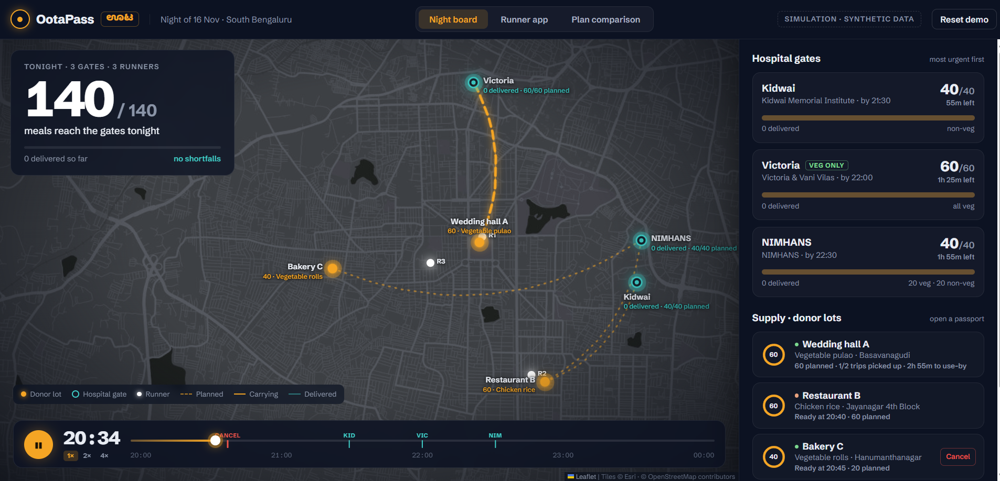
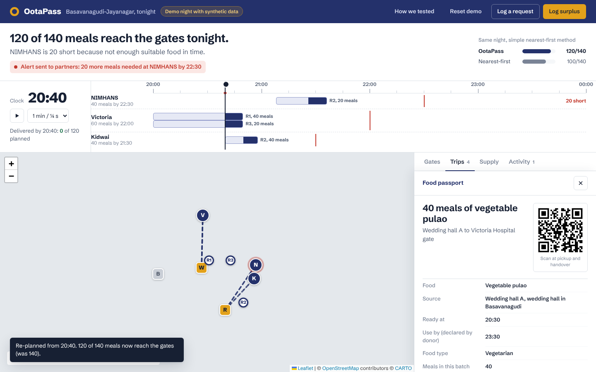
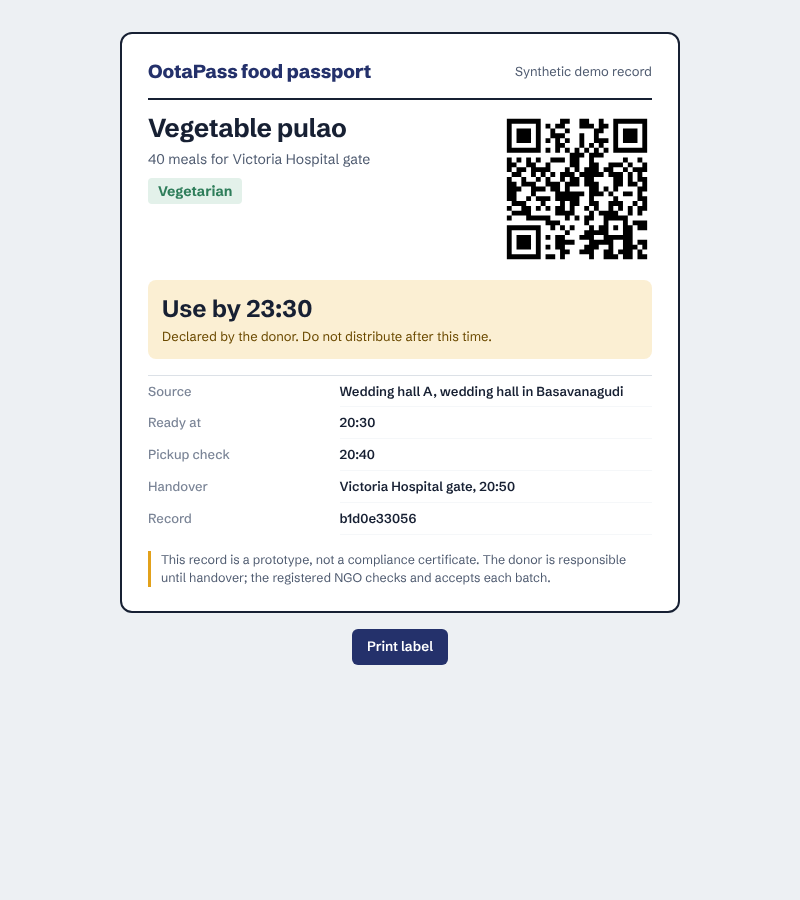

# OotaPass

**Plans tonight's surplus food into labelled dinners for families waiting outside Bengaluru's government hospitals, and when a gate goes short, says exactly why.**

*Oota* means meal in Kannada. OotaPass is a coordinator console for a registered food-recovery NGO. Hospital gate volunteers log roughly how many people need dinner and by when; wedding halls, restaurants, bakeries and supermarkets log their surplus and its use-by time. OotaPass builds one plan for the whole night, re-plans when anyone cancels, and gives every batch a QR food passport.

> Team C1CORE, BMS Institute of Technology and Management. Rewired 2026 online round.
> **All data in this prototype is synthetic.** Donor names, quantities and requests are invented for testing.



## What it does

| | |
|---|---|
| **One plan for the night** | Every gate request, donation and NGO runner goes into a single plan: which food goes to which gate, carried by whom, and when. |
| **Shortfalls with a reason** | Any gate that is still short is labelled with why: not enough food, no free runner, not enough time, or no space to receive. Partners get an alert such as "20 more meals needed at NIMHANS by 22:30". |
| **Cancellation recovery** | When a donor or runner drops out, trips already picked up are kept and the rest of the night is re-planned from that minute. |
| **Food passport** | Each batch has a QR label with the FSSAI-style label fields, the donor's declared use-by time, and a pickup check the NGO accepts or rejects. A rejected batch is removed and the night is re-planned. |
| **Night timeline and map** | Scrub or play the night from 20:00 to 00:00 and watch runners move, trips complete and deadlines approach. |
| **Honest comparison** | Every plan is compared with a simple nearest-first method on the same data. |



## Run it

Needs Python 3.10 or newer.

```bash
pip install -r requirements.txt
python app.py
```

Open <http://127.0.0.1:5000>. The demo night loads automatically. **Reset demo** restores it at any time.
New night console: open http://127.0.0.1:5000/console/ (needs internet for the map tiles).

The map background loads from OpenStreetMap (no API key needed), so it needs an internet connection. Everything else works offline.

### A 60-second demo

1. The headline reads **140 of 140 meals reach the gates tonight.**
2. Drag the clock to **20:40**.
3. Open **Supply**, choose **Cancel donation** on *Bakery C* and confirm.
4. The plan rebuilds: **120 of 140** with OotaPass, **100 of 140** with nearest-first. NIMHANS is marked 20 short with the reason *not enough suitable food in time*, and an alert is sent.
5. Press **Play** to watch the night unfold. Open any trip to see its food passport and QR label.

## How the planner works

The planner is about 200 lines of plain Python in [`ootapass/planner.py`](ootapass/planner.py). Its rules, in order:

1. Serve gate requests in order of deadline, most urgent first.
2. Plan a trip only if it arrives before the gate's deadline **and** the donor's declared use-by time, within the runner's shift, bag size (40 meals) and the gate's receiving capacity.
3. Give non-veg food to gates that accept anything, so veg food is saved for veg-only gates.
4. Pick the trip that carries the most food; on a tie, the one with the least travel.
5. Label every shortfall with the first constraint that blocks it: receiving capacity, food, transport or time.
6. When a donor or runner cancels, keep trips already picked up and plan the rest again from that minute ([`ootapass/night.py`](ootapass/night.py)).

These are deliberately simple greedy rules that anyone on the team can explain on a whiteboard. A mathematical optimiser is a possible later upgrade.

**Assumptions (not measurements):** road distance is 1.4 × the straight line, runners travel at 20 km/h, each handover takes 10 minutes, and a bag holds 40 meals.

## Evidence

Run the benchmark from the repository root:

```bash
python -m bench.benchmark
```

On 500 random synthetic nights (seed 2026), with both methods given exactly the same nights:

| | OotaPass | Nearest-first |
|---|---|---|
| Average share of requested meals delivered | **55.3%** | 49.2% |
| Nights with more / same / fewer meals than nearest-first | 166 / 309 / 25 | |
| Travel per delivered meal | 0.238 km | 0.240 km |

Many nights are deliberately short of food or runners, so neither method reaches 100%. These results test the planning logic, not real-world impact.

## Tests

```bash
python -m unittest
```

The tests check the demo night (140/140, then 120 vs 100 after the bakery cancels), that trips already picked up survive a cancellation, that veg food is saved for veg-only gates, that urgent gates go first, that food is never planned past its use-by time, and that each shortfall reason is detected.

## Project layout

```
app.py                 Flask server and JSON API
ootapass/planner.py    Planner rules, nearest-first baseline, shortfall reasons
ootapass/night.py      Replays the night and re-plans at every change
ootapass/store.py      SQLite storage (standard library only)
ootapass/seed.py       The synthetic demo night
templates/             Console and printable passport label
static/                CSS, JavaScript, Leaflet and font files
bench/benchmark.py     500-night comparison
tests/                 Unit tests
```

## Food safety and responsibility

OotaPass records decisions; it does **not** certify food as safe. The donor is responsible for the food until handover and declares its use-by time, which OotaPass never extends. The registered NGO checks each batch at pickup and is responsible for safe handling until distribution, as the FSSAI (Recovery and Distribution of Surplus Food) Regulations, 2019 set out. Gate requests carry approximate head-counts only, with no names, phone numbers or IDs.



## Declarations

- **Libraries:** [Flask](https://flask.palletsprojects.com/) (BSD-3), [qrcode](https://github.com/lincolnloop/python-qrcode) (BSD), [Leaflet 1.9.4](https://leafletjs.com/) (BSD-2, bundled in `static/vendor`).
- **Map data and tiles:** © OpenStreetMap contributors (ODbL), used under the OSM tile usage policy.
- **Font:** Schibsted Grotesk (SIL Open Font License, bundled in `static/fonts`).
- **AI assistance:** Claude (Anthropic) was used for research, drafting and code assistance.
- **Data:** synthetic. Hospital and area locations are approximate public coordinates.
