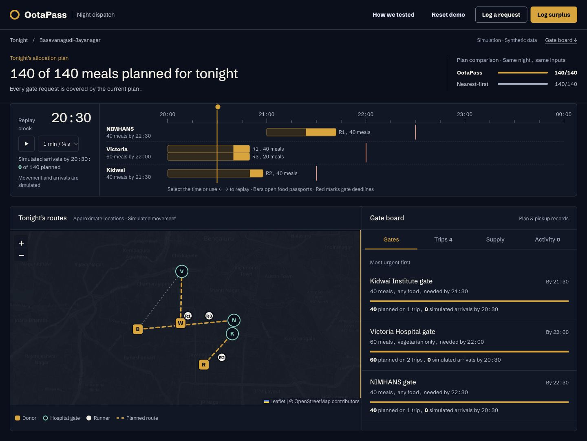

# Frontend redesign: night dispatch desk

The working Flask application at `/` now uses OotaPass’s near-black navy, cream and turmeric identity. Deadline lanes, route geometry and gate shortfall explanations carry the detail. Existing Schibsted Grotesk fonts and bundled Leaflet remain in use; no runtime packages were added.

## Changes

- Refined hierarchy, 4px spacing rhythm, tabular figures, readable secondary text and restrained weights.
- Navy dispatch shell; amber planned routes/actions, teal accepted checks or simulated arrivals, and text-labelled red shortfalls.
- Responsive map and gate board, a dedicated map legend footer, explicit marker names for assistive technology and a direct gate-board jump link.
- Larger form controls, named dialogs, focused server-error feedback, pending submission state and functioning Close buttons. Previously, Close implicitly submitted the form; it now dismisses without an API write.
- Food passport focus return, Escape dismissal and background tab-panel inertness while the passport is open. Cream printable labels retain their QR and donor-declared use-by details.
- Presentation explicitly distinguishes planned allocation, simulated arrivals, recorded pickup acceptance and generated alert text. No delivery or external-notification action was added.

## Scope

Baseline `f3709ce3007ebdf555325c038894def08c36dcc8`. Backend Python, schema/storage, all API routes and payloads, planner calculations, tests, dependencies, benchmark inputs/results and `design/` are byte-identical to baseline. The separate `/console/` remains the existing scripted demonstration. No integration was replaced and no feature removed.

## Design sources and attribution

| Repository | Classification and actual use | Installation/licence |
| --- | --- | --- |
| [Unslop](https://github.com/heydamir/unslop) | Agent skill: product audit, approved direction, ordered spacing/colour/icon/copy/type/layout/detail/visual/motion review. Route map supplies the visual focus; no decorative image generation. | Installed project-locally in `.agents/skills/unslop`; CC BY 4.0, Damir Sokolovsky ([@heydamir](https://x.com/heydamir)). Instructions and original licence retained locally. |
| [Open Design](https://github.com/nexu-io/open-design) | Reference workspace and example catalog. Inspected dashboard examples and design-system documentation; adapted token discipline, quiet surfaces and information hierarchy. Generic KPI templates and mock-data fallbacks were unsuitable. | Full workspace not installed. Installed its bundled `web-design-guidelines` skill locally for review (MIT, Copyright 2025 Vercel Labs). Workspace Apache 2.0; no workspace application code/assets copied. |
| [UI UX Pro Max](https://github.com/nextlevelbuilder/ui-ux-pro-max-skill) | Agent skill and local search tool: system guidance plus focused form-error and compact-label searches. Used responsive, contrast, focus and text-reflow guidance; rejected landing-page structure, font and palette suggestions that conflicted with OotaPass. | Documented `npx ui-ux-pro-max-cli init --ai codex` succeeded; placed in project `.agents/skills/ui-ux-pro-max`. MIT, Copyright 2024 Next Level Builder. Licence retained locally. |

Skills are local development tools, excluded through `.git/info/exclude`; no skill payloads or backend dependencies are included in this PR. They are available to a new agent session, and their instructions were read directly in this session. No paid design service was used.

## Verification

- Existing `python -m unittest -v`: **7/7 pass**, both baseline and final.
- `python -m bench.benchmark`: **500 synthetic nights, seed 2026**, exact original results: coverage **55.3% / 49.2%**, more/same/fewer **166 / 309 / 25**, travel per meal **0.238 / 0.240 km**. `bench/results.json` unchanged.
- Isolated Flask test-client smoke: request validation/save, surplus save, cancellation, acceptance/rejection, passport/QR, reset, zero-trip state and benchmark all pass. No test files modified.
- Actual browser flows: request error + save, surplus save, Bakery C cancellation at 20:40 (**120/140 vs 100/140**, NIMHANS **20 short / Food**), runner-dropout confirmation + cancellation, Gates/Trips/Supply/Activity, replay play/pause/speed/keyboard scrub, map zoom, passport open/check/accept/reject/Escape, label render, evidence and empty states.
- No horizontal page overflow at **375, 390, 768, 1024, 1440px**. Mobile form and passport checked. No captured browser console warnings or JavaScript errors.
- `node --check static/js/app.js` and `git diff --check` pass.
- Primary/secondary/muted text contrast on main surfaces and action/error/accepted text pairs exceed **4.5:1**. Reduced-motion rules retained and reviewed.

Limits: verification used the Chromium-based in-app browser. Safari/Firefox and physical print output were not tested. Reduced-motion CSS was reviewed without OS preference emulation. Map tiles still need network, as before. No actual partner messaging or delivery confirmation backend exists; the UI now labels generated alerts and simulated arrivals accordingly.

## Screenshots

[Desktop before](frontend/before-desktop.jpg) · [Desktop after](frontend/after-desktop.jpg) · [Mobile before](frontend/before-mobile.jpg) · [Mobile after](frontend/after-mobile.jpg) · [Cancellation](frontend/after-cancellation.jpg) · [Printable label](frontend/after-label.jpg)



## Run locally

```bash
python3 -m venv .venv
.venv/bin/pip install -r requirements.txt
.venv/bin/python app.py
```

Open `http://127.0.0.1:5000/` for the working app, or `http://127.0.0.1:5000/console/` for the unchanged scripted demo. To use a separate QA database and port, prefix the run command with `OOTAPASS_DB=/tmp/ootapass-qa.db PORT=5055`.
