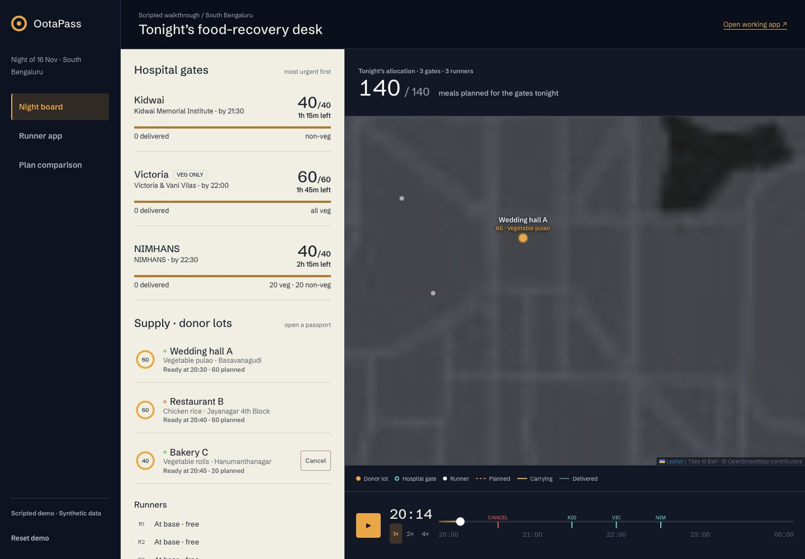

# OotaPass frontend redesign

Both browser entry points share a rebuilt navy, cream and amber design language. The working Flask application at `/` keeps its API-backed workflows; `/console/` keeps its existing scripted Night board, Runner app and Plan comparison. The two remain explicitly distinguished.

## What changed

- Persistent operations navigation replaces the original narrow panel tabs. Night board, Dispatch trips, Food & runners and Activity log each have a distinct full-width view; mobile navigation keeps all actions available.
- Cream gate dispatch sheets show deadlines, dietary needs, receiving capacity, allocated portions, shortfall reasons and linked trip passports. The route map sits alongside the gates with its own legend and simulation context.
- Trips use a pickup/arrival manifest with food, donor-to-gate route, runner, status and passport links. Food supply uses batch declarations with ready/use-by/allocation columns and separate runner capacity rows. Activity uses a chronological decision trail.
- Request/surplus forms use numbered semantic field groups, paper surfaces, native controls, pending submission feedback and focused server errors.
- Food passports use native modal dialogs, keyboard dismissal/focus return, QR records, donor-declared use-by emphasis, and the unchanged acceptance/rejection actions. Printable labels use a redesigned batch sheet with a separate QR column and planned-handover context.
- Console Night board now has persistent navigation, a receiving sheet alongside the map, integrated map/replay zones and readable donor rows. Runner app is a two-column handover workbench; Plan comparison is a cream analytical sheet. All scripted recovery, QR/check and runner-sequence controls remain.
- Console map fitting now responds to its actual container with padding suited to the new layout. Mobile labels stay inside the map. Added keyboard equivalents for console donor rows and replay; closed passports are hidden from assistive technology.

## Preserved scope

Baseline: `f3709ce3007ebdf555325c038894def08c36dcc8`. All Python/backend files, database/storage behavior, API routes/methods/payloads, planner allocation rules, tests, dependencies and benchmark inputs/results remain byte-identical. No runtime packages added. Console `buildPlan` and `runnerPos` remain unchanged; console JavaScript edits concern map layout, keyboard access, visibility and presentation text. No real integration was replaced, no business feature added, and no existing action removed.

## Design repositories and credit

| Source | Actual use | Installation / licence |
| --- | --- | --- |
| [Unslop](https://github.com/heydamir/unslop), Damir Sokolovsky ([@heydamir](https://x.com/heydamir)) | Audit; approved dispatch-desk direction; spacing, colour, icon, copy, typography, composition, detail, product-visual and motion passes. The map and dispatch records carry the detail. | Project-local skill installed; CC BY 4.0 attribution and original licence retained. |
| [Open Design](https://github.com/nexu-io/open-design) | Reference/example workspace: design-system contracts, IBM/Carbon reference principles of productive density and surface zoning, hierarchy and state-coverage resources. Adapted principles to OotaPass, retaining its type and palette. Bundled Web Interface Guidelines used for accessibility review. | Full workspace not installed or copied. Workspace Apache 2.0; installed guidelines skill is MIT, Copyright 2025 Vercel Labs. No brand assets or example application code copied. |
| [UI UX Pro Max](https://github.com/nextlevelbuilder/ui-ux-pro-max-skill) | Logistics/Delivery search identified operations monitoring and route analytics; focused navigation/form/reflow guidance informed the manifest and responsive views. Rejected unrelated landing-page and replacement-palette defaults. | Documented CLI installation succeeded; MIT, Copyright 2024 Next Level Builder. Original licence retained. |

Skills are installed locally under `.agents/skills` and excluded from Git through the local exclude file; they are development tools, not runtime application dependencies. No paid image-generation service used, no stack migration.

## Validation

- Original tests: **7/7 pass** before and after.
- Benchmark: **500 synthetic nights, seed 2026**, exact original results: coverage **55.3% / 49.2%**, more/same/fewer **166 / 309 / 25**, travel per meal **0.238 / 0.240 km**. Result file unchanged.
- Isolated API smoke passes: request validation/save, surplus save, donor cancellation, pickup acceptance/rejection, passport/QR, reset, no-trip state and benchmark.
- Working browser app: all four navigation views, request error/save, surplus save, cancellation/replanning, passport acceptance/Escape, printable label, mobile form/passport and keyboard navigation. Bakery C at 20:40 remains **120/140 vs 100/140**, NIMHANS **20 short / Food**. Earlier map zoom/replay/runner-dropout/rejection/evidence flows are retained; API smoke rechecks rejection.
- Console browser: keyboard replay into shortfall, recovery search/acceptance, donor passport via keyboard, all three checks, complete runner pickup → arrival → QR → handover → replay, comparison **120 vs 100**, all three view switches.
- All four working views and all three console views: no horizontal page overflow at **375, 768, 1024, 1440px**. Additional form/passport/label checks at **390px**. Mobile map labels measured inside the viewport.
- No captured browser JavaScript warnings/errors in final responsive checks. Syntax and whitespace checks pass.

Limits: Chromium-based in-app browser only. Physical printing and OS reduced-motion emulation were not tested; print and reduced-motion CSS reviewed. Maps still need tile-network access. Console remains a scripted demonstration and its confirmations are not live operational events.

## Screenshots

[Working app before](frontend/before-desktop.jpg) · [Working app after](frontend/after-desktop.jpg) · [Mobile](frontend/after-mobile.jpg) · [Dispatch trips](frontend/trips.jpg) · [Supply](frontend/supply.jpg) · [Passport](frontend/passport.jpg) · [Label](frontend/after-label.jpg)

[Console before](frontend/console-before.jpg) · [Night board](frontend/console-desktop.jpg) · [Console mobile](frontend/console-mobile.jpg) · [Runner app](frontend/runner.jpg) · [Plan comparison](frontend/comparison.jpg)



## Run locally

```bash
python3 -m venv .venv
.venv/bin/pip install -r requirements.txt
.venv/bin/python -m flask --app app run --port 5055
```

Open `http://127.0.0.1:5055/console/` for the redesigned walkthrough, or `http://127.0.0.1:5055/` for the redesigned working planner. To isolate QA data, prefix the command with `OOTAPASS_DB=/tmp/ootapass-qa.db`.
